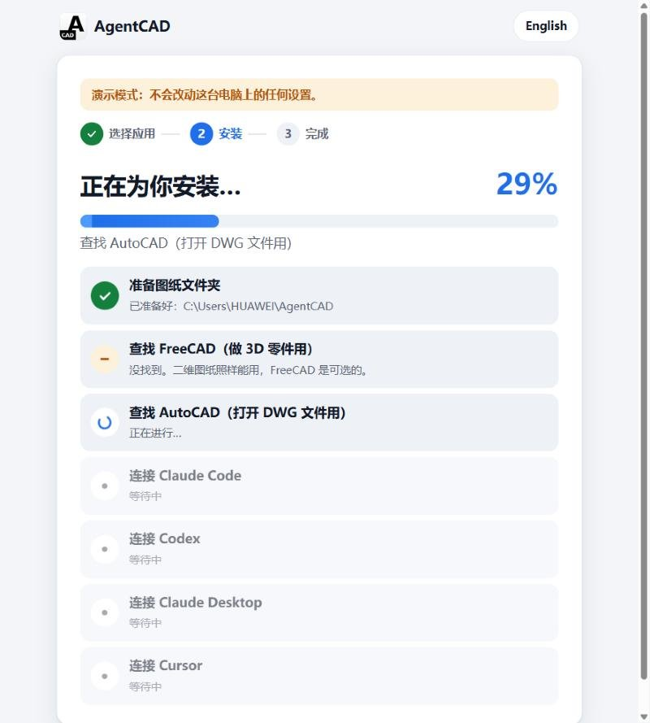

<p align="center">
  <picture>
    <source media="(prefers-color-scheme: dark)" srcset="docs/assets/brand/logo-dark.svg">
    
  </picture>
</p>

<p align="center"><b>The CAD runtime built for AI agents.</b><br>
Your coding agent creates, edits, checks and exports real engineering drawings and 3D parts, through tools designed for it rather than for a mouse.</p>

**We're building AgentCAD to disrupt AutoCAD.** Traditional CAD software was built for humans to click, drag and draw. AgentCAD is CAD built for agents, not humans.

## What it is

AgentCAD is an open-source program you install on your machine, the CAD engine your agent calls for **2D drawings** (DXF; DWG when AutoCAD is installed) and **parametric 3D parts** (FreeCAD `.FCStd`, exported to STEP and STL). It is not a GUI app and not a prompt or skill. The core runs on [ezdxf](https://ezdxf.mozman.de/), is MIT-licensed and needs no commercial software. It comes as:

- **An MCP server** (the main way to use it). Claude Code, Codex or any MCP client gets 34 CAD tools in the full profile, or 3 discovery tools with schemas fetched on demand. You talk to your agent; the agent uses AgentCAD.
- **A CLI, a Python library and an HTTP API** with the same tools, for scripts and pipelines.

<p align="center">
  
  
</p>
<p align="center"><sub>Both drawings were made by an agent through AgentCAD and plotted by AutoCAD 2027. Left: "make an A3 sheet with a 1:2 viewport". Right: "dimension this part so the shop can make it".</sub></p>
<p align="center">
  
  
</p>
<p align="center"><sub>A 3D part through the same tools, here driven from the CLI: one batch of 12 operations builds the hub (left); one <code>set_parameters</code> call makes the flange Ø160 and the bore Ø40, and the fillet, chamfer and bolt holes rebuild (right). Previews rendered by AgentCAD's <code>export_drawing</code>; the operations are in <a href="docs/assets/part3d/">docs/assets/part3d/</a>.</sub></p>

## Get started in two minutes

**No terminal needed: three steps.**

| 1. Download and double-click | 2. Pick your apps, watch it install | 3. Done: copy a first sentence |
|:---:|:---:|:---:|
|  |  |  |
| [Windows installer](https://github.com/lizaixi01/AgentCAD/releases/latest/download/AgentCAD-Setup.cmd) · [macOS / Linux](https://github.com/lizaixi01/AgentCAD/releases/latest/download/AgentCAD-Setup-mac.zip) | Apps found on your computer are already ticked | An AgentCAD icon on your desktop opens your drawings any time |

English and Chinese. Already installed? Run the installer again and tap "Check it". Details: [docs/install.md](docs/install.md).

From a clone, for development: install from this repository. The `agentcad` package on PyPI is an unrelated project. When AgentCAD is published there, it will be as `agentcad-runtime`. To let the agent build 3D parts from CadQuery scripts, as in the BenchCAD run, install with `-e ".[dev,cadquery]"` and add `--allow-scripts` before `mcp-config` in the commands below.

```bash
git clone https://github.com/lizaixi01/AgentCAD.git
cd AgentCAD
uv venv .venv --python 3.12
uv pip install --python .venv -e ".[dev]"
```

**Connect Claude Code.** This writes `.mcp.json` in the repository root. The file points at your venv's interpreter and your `playground/` folder, so it works wherever you cloned and on any OS. It is not committed: it holds paths for your machine only, so run the command again if you move the checkout or recreate the venv. On Windows the command is `.venv\Scripts\agentcad.exe`. Open a new Claude Code session in the repository afterwards.

```bash
.venv/bin/agentcad --root playground mcp-config --write
```

**Connect Codex.** This appends an `[mcp_servers.agentcad]` table to `~/.codex/config.toml`. The table includes `default_tools_approval_mode = "approve"`; without it, Codex rejects every tool call under `approval_policy="never"`. With either command, leave out `--write` to just print the config; `--read-only` and `--allow-scripts` go into the generated config as well.

```bash
.venv/bin/agentcad --root playground mcp-config --client codex --write
```

**Then just ask** (more prompts in [playground/README.md](playground/README.md)):

> - Draw a 200×100 mounting plate with R8 corners, four Ø12 holes 15 mm from the edges and a Ø40 hole in the middle. Dimension it, save it as plate.dxf, check it, and export plate.svg.
> - Make the plate 240 wide and keep the holes 15 mm from the edges. Tell me what changed.
> - Undo that.
> - Make an A3 sheet for plate.dxf with a 1:2 viewport and drawing number MP-240 in the title block.
> - Model a flanged hub as hub.FCStd: Ø120 × 14 flange, Ø60 hub 26 high, Ø30 bore through, six Ø12 bolt holes on a Ø90 circle, R4 fillet where the hub meets the flange. Make the flange and bore diameters parameters, show me a preview, and export hub.step.

## Why AgentCAD

Your agent can already write code. It still can't do CAD: asked to edit a drawing, it writes a throwaway script against a DXF library. That works until it doesn't: the script overwrites the file, there is no undo, nobody checks the result, and the next session has no idea what the last one changed. AgentCAD gives the agent a CAD runtime instead:

- **Operations, and scripts held to the same rules.** 71 typed 2D operations (draw, edit, annotate, layers, blocks, sheets and viewports, industry symbols) and 19 for 3D parts (sketch, pad, pocket, revolve, hole, fillet, pattern, loft, sweep…), each with a JSON schema. Batches are atomic: if one step fails, the file is untouched. A 3D part can also start from a CadQuery script, which runs as one transaction: validated, checkpointed and undoable like any operation.
- **Every change is reversible.** Checkpoints before every edit, a diff of what changed, and a durable journal, so a new session can see and undo what an earlier one did.
- **Checked by something other than the agent.** An independent validator re-reads the file from disk and reports problems as structured errors the agent can act on: integrity and duplicates, geometry that doesn't close, dimensions that disagree with the part, requirements you pass in, text that will print too small in a viewport, sheets it didn't check. For 3D parts: one valid solid, its size and volume, the holes it has, and features that failed to rebuild.
- **The agent can see its work.** 3D parts export shaded PNG previews from any view direction, returned inline so the agent can compare them with what it was asked to build. Given a reference image, each view comes back aligned to it, with a match score for its outline and the edges inside it, and a diff. `inspect_image` magnifies small dimension callouts and section hatching in a PNG/JPEG/WebP source drawing and returns source pixel coordinates; section depths and the side of each feature still need to be interpreted from the drawing.
- **Real drawings, not just new ones.** Paper-space layouts, title blocks with attributes, DWG import/export and AutoCAD AUDIT through an optional headless AutoCAD backend.
- **Safe by default.** Workspace sandbox, read-only mode, operation allow-lists. Scripts (ezdxf for drawings; CadQuery or FreeCAD Part code for 3D parts) are off unless you turn them on.

## Results at a glance

<p align="center">
  <picture>
    <source media="(prefers-color-scheme: dark)" srcset="docs/assets/results/results-dark.svg">
    
  </picture>
</p>

| Benchmark | Headline | What it compares |
|---|---|---|
| [Our timed trials](docs/benchmarks.md#timed-trials-and-benchcad-vision2code) | Faster than writing code on most tasks; 1.7–1.9× faster than AutoCAD MCP Pro; undo across sessions 3/3 vs Pro's 0/3 | The same agent and model, through AgentCAD vs. writing ezdxf code or using AutoCAD MCP Pro |
| [BenchCAD Vision2Code](docs/benchmarks.md#timed-trials-and-benchcad-vision2code), 100 tasks | Mean IoU: Claude Code 0.745 vs 0.682; Codex 0.876 vs 0.918 | Through AgentCAD vs. the same agent writing CadQuery itself; our run, not the BenchCAD leaderboard |
| [U-C4N v8 runtime matrix](docs/benchmarks.md#autocad-mcp-benchmark) | 31/31 (100/100), tied with AutoCAD MCP Pro | 31 fixed tasks without an LLM, rerun locally; not an official listing |
| [Source-capability review](docs/benchmarks.md#source-capability-comparison) | **AgentCAD 100/100 · AutoCAD MCP Pro 93/100** | Same frozen local rubric, separately reviewed at `290ced3` / `58a05dd`; M14 and manufacturing gaps closed. [Evidence and limits](docs/source-capability-recheck.md). Not an upstream ranking |
| [BenchCAD 2](docs/benchmarks.md#benchcad-2-development-samples), 9 development samples | 53.45/100 with GPT-6.1 Sol; 56.79 with GPT-6 Astra | Two models in Codex, both through AgentCAD; no run without AgentCAD, and not the Core set or a leaderboard result |
| [Parametric CAD Bench V3 pilot](docs/benchmarks.md#parametric-cad-bench-v3-pilot) | 55.43/100 on 6 tasks | Codex with GPT-6.1 Sol building native PartDesign parts, no comparison arm; not a leaderboard submission |

**Where it doesn't win yet:** Codex still rebuilt the BenchCAD Vision2Code parts more accurately by writing CadQuery itself (0.918 vs 0.876), though through AgentCAD it took a third less time. For a batch of near-identical drawings, one generated script is faster and cheaper. AgentCAD sessions also read about 2× the input tokens.

## Other ways to use it

- **CLI, Python and HTTP.** Core drawing tools are also CLI commands that print one JSON envelope, such as `agentcad --root ./work apply part.dxf --ops-file ops.json`; likewise `create`, `validate`, `diff`, `rollback` and `export` ([docs/tutorial.md](docs/tutorial.md)). The same `Runtime` is available from Python and over HTTP (`agentcad --root work serve`, then `POST /v1/<tool>`). All four interfaces share one service layer.
- **Watch the agent work.** `agentcad --root ./work viewer` serves a live, read-only view of the workspace at `http://127.0.0.1:8770/`. Drawings and 3D parts update as the agent commits, with a timeline of every change: click one to see that version and what it changed. It works with any agent, because it only reads the files. See [docs/viewer.md](docs/viewer.md).

## What's inside

| | |
|---|---|
| Operations | 71 for 2D: draw, edit (trim, fillet, offset, arrays, break/join, purge), annotate (linear, radial, angular and ordinate dimensions, leaders, tables, title blocks), layers, blocks with attributes, sheets and viewports, and industry libraries. [Every operation](docs/operations.md) |
| Industry libraries | P&ID (ISO 10628 / ISA-5.1): 24 symbols, process and signal lines; a valve placed on a pipe cuts the pipe. GD&T (ISO 1101): feature control frames with all 14 characteristics, modifiers and datums; datum feature and surface texture symbols. ISO bolts, nuts, washers and cap screws (M3–M24), 60xx/62xx/63xx bearings, clearance, tapped and counterbored holes. `standard_library` looks up sizes and lists a drawing's parts |
| Engineering workflows | Native P&ID connectivity/readback, orthogonal plans with measured room areas, revolved-part views with BOM/balloons, preliminary foreign-plant takeoff, guarded edits and physical dimension verification. [Contracts and limits](docs/engineering-workflows.md) |
| Live AutoCAD | `autocad_live` (Windows, COM) shows the agent's drawing in the user's running AutoCAD and pulls the user's edits back as a checkpointed, validated change. Raw command lines are off by default |
| 3D parts | Parametric FreeCAD parts driven by named parameters; edge and face selections survive edits; STEP/STL export and shaded PNG previews. Needs FreeCAD 1.1 (optional): [docs/part-3d.md](docs/part-3d.md) |
| File formats | DXF R12–R2018, SVG and JSON export. PDF plotting with no extra software: one page per sheet, paper layouts 1:1, model space at a standard scale, Chinese text included. DWG import/export and AUDIT through headless AutoCAD (accoreconsole), optional |
| Tests | Pinned assessment regression at `290ced3`: **885 passed, 8 skipped** (CadQuery-dependent), with AutoCAD 2027 and FreeCAD 1.1.4 enabled. [Windows/Linux/macOS CI and retained evidence](docs/source-capability-recheck.md#verification-and-production-evidence) report optional-backend skips separately |

## Where it stands

- **AgentCAD is early.** 3D parts have been measured only on small benchmark samples, one run per task (above). They are single bodies without assemblies, and they can't be turned into 2D drawings yet. The earlier agent drafting evidence covers 12 tasks on two agents.
- DWG needs AutoCAD on the machine. The live session has been [checked in AutoCAD 2027](docs/comparison-native-dwg.md#实时编辑文件锁修复复核): 12 consecutive edits synchronized across four flows on two drawings, including pull, conflict protection and checkpoint recovery. It opens new DXFs read-only so AgentCAD can replace them; GUI edits come back through pull. Other AutoCAD versions remain untested.
- The industry libraries cover common P&ID, GD&T and ISO fastener content, not a full catalogue.
- Readability checks cover text height, and plot layout still needs a human eye.
- What's missing is tracked in [docs/limitations-roadmap.md](docs/limitations-roadmap.md).

## Documentation

| Document | What it covers (most are in Chinese) |
|---|---|
| [docs/tutorial.md](docs/tutorial.md) | Step-by-step tutorial: generate, validate, revise, roll back, DWG, connecting agents |
| [docs/architecture.md](docs/architecture.md) | Architecture, data model, transactions, error envelope |
| [docs/operations.md](docs/operations.md) | Reference for every operation (generated from code) |
| [docs/part-3d.md](docs/part-3d.md) | 3D parametric parts: FreeCAD backend, operations, selectors, validation |
| [docs/viewer.md](docs/viewer.md) | Live viewer: watch drawings and parts change in the browser, timeline, diffs |
| [docs/benchmarks.md](docs/benchmarks.md) | Every benchmark and comparison: results, caveats, and the full reports with run logs and graders |
| [docs/limitations-roadmap.md](docs/limitations-roadmap.md) | Known limitations and roadmap |

## License

MIT
