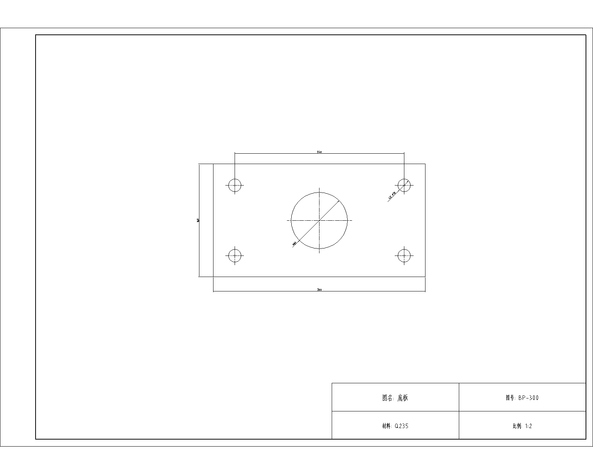
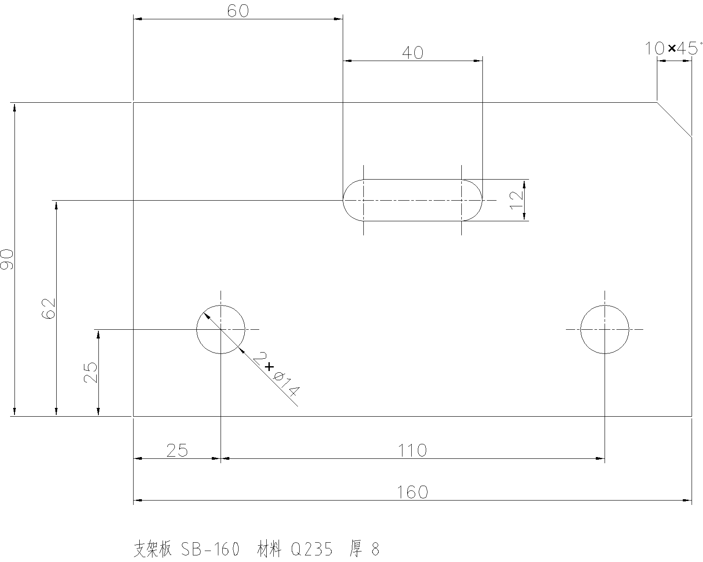
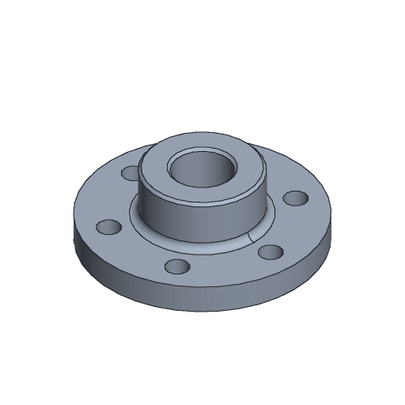
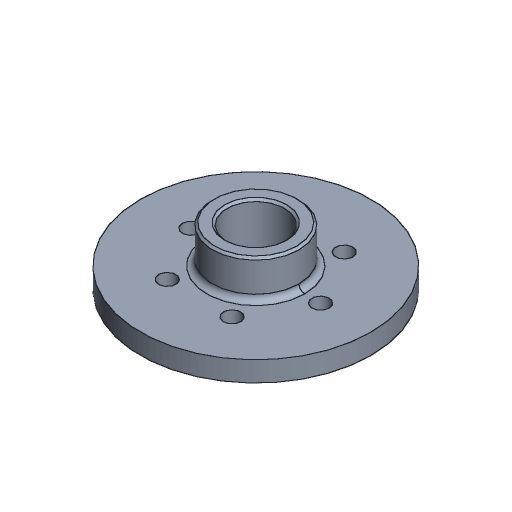

<p align="center">
  <picture>
    <source media="(prefers-color-scheme: dark)" srcset="docs/assets/brand/logo-dark.svg">
    
  </picture>
</p>

<p align="center"><b>The CAD runtime built for AI agents.</b><br>
Your coding agent creates, edits, checks and exports real engineering drawings and 3D parts, through tools designed for it rather than for a mouse.</p>

**We're building AgentCAD to disrupt AutoCAD.** Traditional CAD software was built for humans to click, drag and draw. AgentCAD is CAD built for agents, not humans.

## What it is

AgentCAD is an open-source program you install on your machine. It is not a GUI app and not a prompt or skill. It is the CAD engine your agent calls:

- **An MCP server** (the main way to use it). Claude Code, Codex or any MCP client gets 25 CAD tools. You talk to your agent; the agent uses AgentCAD.
- **A CLI, a Python library and an HTTP API** with the same tools, for scripts and pipelines.

Behind those tools:

- **2D drawings:** DXF; DWG when AutoCAD is installed.
- **Parametric 3D parts:** FreeCAD `.FCStd`, exported to STEP and STL.

The core is MIT-licensed and needs no commercial software.

<p align="center">
  
  
</p>
<p align="center"><sub>Both drawings were made by an agent through AgentCAD and plotted by AutoCAD 2027. Left: "make an A3 sheet with a 1:2 viewport". Right: "dimension this part so the shop can make it".</sub></p>
<p align="center">
  
  
</p>
<p align="center"><sub>A 3D part through the same tools, here driven from the CLI: one batch of 12 operations builds the hub (left); one <code>set_parameters</code> call makes the flange Ø160 and the bore Ø40, and the fillet, chamfer and bolt holes rebuild (right). Previews rendered by AgentCAD's <code>export_drawing</code>; the operations are in <a href="docs/assets/part3d/">docs/assets/part3d/</a>.</sub></p>

---

## Your agent can already write code. It still can't do CAD.

Ask an agent to edit a drawing today and it writes a throwaway script against a DXF library. That works until it doesn't: the script overwrites the file, there is no undo, nobody checks the result, and the next session has no idea what the last one changed.

AgentCAD gives the agent a CAD runtime instead of a blank Python file:

- **Operations, and scripts held to the same rules.** 62 typed 2D operations (draw, edit, annotate, layers, blocks, sheets and viewports, industry symbols) and 19 for 3D parts (sketch, pad, pocket, revolve, hole, fillet, pattern, loft, sweep…), each with a JSON schema. Batches are atomic: if one step fails, the file is untouched. A 3D part can also start from a CadQuery script, which runs as one transaction: validated, checkpointed and undoable like any operation.
- **Every change is reversible.** Checkpoints before every edit, a diff of what changed, and a durable journal, so a new session can see and undo what an earlier one did.
- **Checked by something other than the agent.** An independent validator re-reads the file from disk and reports problems as structured errors the agent can act on: geometry that doesn't close, dimensions that disagree with the part, text that will print too small, sheets it didn't check. For 3D parts: one valid solid, its size and volume, the holes it has, and features that failed to rebuild.
- **The agent can see its work.** 3D parts export shaded PNG previews from any view direction, returned inline to the agent so it can compare them with what it was asked to build. Given a reference image, each view comes back aligned to it, with a match score and a diff. A live browser viewer shows you the same drawings and parts as they change.
- **It can inspect the source drawing closely.** `inspect_image` magnifies a region of a PNG/JPEG/WebP drawing, including small dimension callouts and section hatching. It returns an inline image and source pixel coordinates without changing the input. Section depths and the side of each feature still need to be interpreted from the drawing.
- **Real drawings, not just new ones.** Paper-space layouts, title blocks with attributes, DWG import/export and AutoCAD AUDIT through an optional headless AutoCAD backend.
- **Safe by default.** Workspace sandbox, read-only mode, operation allow-lists. Scripts (ezdxf for drawings; CadQuery or FreeCAD Part code for 3D parts) run as transactions and are off unless you turn them on.

## Results

<p align="center">
  <picture>
    <source media="(prefers-color-scheme: dark)" srcset="docs/assets/results/results-dark.svg">
    
  </picture>
</p>

Every comparison keeps the agent and model the same and changes only the tools.

- **Faster.** On most tasks, runs were 1.4–3× faster than the same agent writing ezdxf code. They were 1.7–1.9× faster than the same agent using AutoCAD MCP Pro, including with AutoCAD 2027 open.
- **Undo that survives a new session.** In a five-round revision, AgentCAD restored an earlier hole size from its journal 3/3 times. With AutoCAD MCP Pro the agent could not, 0/3.
- **3D from pictures.** On 100 [BenchCAD](https://arxiv.org/abs/2605.10865) Vision2Code tasks, Claude Code rebuilt parts from four views more accurately through AgentCAD than by writing CadQuery itself: mean IoU 0.754 vs 0.682. Through AgentCAD it still wrote CadQuery, but each script ran as a checked transaction, and it could compare its part with the target and get a match score. This is our own run, not the BenchCAD leaderboard, where models write CadQuery in one shot.
- **Where it doesn't win yet:** Codex still rebuilt those parts more accurately by writing CadQuery itself (0.918 vs 0.857), though through AgentCAD it took 39% less time. For a batch of near-identical drawings, one generated script is faster and cheaper. AgentCAD sessions also read about 2× the input tokens.

Samples are small (2–3 runs per task, one run per BenchCAD task). The full reports with logs and graders:
- [vs. writing code, Claude Code](docs/comparison-claude-code.md)
- [vs. writing code, Codex](docs/comparison-hard-tasks.md)
- [vs. AutoCAD MCP Pro](docs/comparison-autocad-mcp-pro.md)
- [native DWG in AutoCAD 2027](docs/comparison-native-dwg.md)
- [BenchCAD](examples/benchcad/README.md)
- [Parametric CAD Bench V3 pilot: six tasks with native PartDesign operations](examples/parametric_cad_bench/README.md)

## Get started in two minutes

```bash
git clone https://github.com/lizaixi01/AgentCAD.git
cd AgentCAD
uv venv .venv --python 3.12
uv pip install --python .venv -e ".[dev]"
```

Install from this repository. The `agentcad` package on PyPI is an unrelated project. When AgentCAD is published there, it will be as `agentcad-runtime`.

**Connect Claude Code.** This writes `.mcp.json` in the repository root. The file points at your venv's interpreter and your `playground/` folder, so it works wherever you cloned and on any OS. Open a new Claude Code session in the repository afterwards.

```bash
.venv/bin/agentcad --root playground mcp-config --write
```

On Windows the command is `.venv\Scripts\agentcad.exe`. `.mcp.json` is not committed: it holds paths for your machine only. Run the command again if you move the checkout or recreate the venv.

**Connect Codex.** This appends an `[mcp_servers.agentcad]` table to `~/.codex/config.toml`. The table includes `default_tools_approval_mode = "approve"`; without it, Codex rejects every tool call under `approval_policy="never"`.

```bash
.venv/bin/agentcad --root playground mcp-config --client codex --write
```

Leave out `--write` to just print the config. `--read-only` and `--allow-scripts` go into the generated config as well. To let the agent build 3D parts from CadQuery scripts, as in the BenchCAD run, install with `-e ".[dev,cadquery]"` and pass `--allow-scripts`.

**Then just ask:**

> Draw a 200×100 mounting plate with R8 corners, four Ø12 holes 15 mm from the edges and a Ø40 hole in the middle. Dimension it, save it as plate.dxf, check it, and export plate.svg.

> Make the plate 240 wide and keep the holes 15 mm from the edges. Tell me what changed.

> Undo that.

> Make an A3 sheet for plate.dxf with a 1:2 viewport and drawing number MP-240 in the title block.

> Model a flanged hub as hub.FCStd: Ø120 × 14 flange, Ø60 hub 26 high, Ø30 bore through, six Ø12 bolt holes on a Ø90 circle, R4 fillet where the hub meets the flange. Make the flange and bore diameters parameters, show me a preview, and export hub.step.

More prompts to try: [playground/README.md](playground/README.md).

## Prefer the command line?

Core drawing tools are also available as CLI commands that print one JSON envelope:

```bash
agentcad --root ./work create part.dxf --units mm
agentcad --root ./work apply part.dxf --ops-file ops.json
agentcad --root ./work validate part.dxf
agentcad --root ./work diff part.dxf
agentcad --root ./work rollback part.dxf
agentcad --root ./work export part.dxf part.svg
```

The same `Runtime` is available from Python and over HTTP (`agentcad --root work serve`, then `POST /v1/<tool>`). All four interfaces share one service layer.

## Watch the agent work

`agentcad --root ./work viewer` serves a live, read-only view of the workspace at `http://127.0.0.1:8770/`. Drawings and 3D parts update as the agent commits, with a timeline of every change: click one to see that version and what it changed. It works with any agent, because it only reads the files. See [docs/viewer.md](docs/viewer.md).

## What's inside

The fixed [U-C4N v8 execution matrix](docs/comparison-upstream-benchmark-v8.md) now passes 31/31 through AgentCAD's native MCP workflows, tying the locally rerun reference. This is independent local evidence, not an official leaderboard listing.

| | |
|---|---|
| Operations | 71: draw (lines to splines, hatches, polygons), edit (trim, fillet, offset, arrays, break/join, purge), annotate (linear, radial, angular, ordinate dimensions, leaders, tables, title blocks), layers, blocks with attributes, sheets and viewports, and industry libraries |
| Industry libraries | P&ID (ISO 10628 / ISA-5.1): 24 symbols, process and signal lines; a valve placed on a pipe cuts the pipe itself. GD&T (ISO 1101): feature control frames with all 14 characteristics, modifiers and datums, datum feature and surface texture symbols. ISO parts: bolts, nuts, washers, cap screws (M3–M24) and 60xx/62xx/63xx bearings, clearance, tapped and counterbored holes. One op each, sized to the annotation scale; `standard_library` looks up sizes and lists a drawing's parts |
| Agent tools (MCP) | 34 in the default profile, including `apply_operations`, `apply_batch`, `validate_drawing`, `get_diff`, `rollback`, `history`, `export_drawing`, `standard_library`, `autocad_live`, `inspect_image`. Optional discovery profile advertises 3 tools; fetch complete schemas on demand |
| Engineering workflows | Native P&ID connectivity/readback, orthogonal plans with measured room areas, revolved-part views with BOM/balloons, and preliminary foreign-plant takeoff. Guarded edits, physical dimension verification and formula-safe table exports. [Contracts and limits](docs/engineering-workflows.md) |
| Live AutoCAD | `autocad_live` works next to the user's running AutoCAD (Windows, COM): shows the agent's drawing there, reloads it after every change (`AGENTCAD_LIVE_SYNC=1`), and pulls the user's edits back as a normal checkpointed, validated change. Raw command lines are off unless `AGENTCAD_ALLOW_LIVE_COMMANDS=1` |
| Validation | Independent re-read of the file: integrity, duplicates, dimension text vs. geometry, requirements you pass in, printed text height per viewport, coverage of sheets not checked |
| 3D parts | Parametric FreeCAD parts (`.FCStd`) through the same tools: sketches, pad, pocket, revolve, holes, fillets, chamfers, shells, patterns, lofts, sweeps, helices, driven by named parameters. Edge and face selections survive edits. STEP/STL export and shaded PNG previews. Needs FreeCAD 1.1 (optional) — see [docs/part-3d.md](docs/part-3d.md) |
| File formats | DXF R12–R2018, SVG and JSON export. PDF plotting with no extra software: one page per sheet, paper layouts 1:1, model space at a standard scale, Chinese text included. DWG import/export and AUDIT through headless AutoCAD (accoreconsole), optional |
| Tests | 339 automated tests, including 27 cases checked against AutoCAD 2027 behaviour and 57 3D-part tests (51 of them build parts in FreeCAD 1.1) |

Runs on [ezdxf](https://ezdxf.mozman.de/) (MIT). The core needs no commercial software.

## Where it stands

AgentCAD is early. 3D parts have been measured on one benchmark sample (Vision2Code, one run per task); they are single bodies without assemblies, and they can't be turned into 2D drawings yet. DWG needs AutoCAD on the machine. The industry libraries cover common P&ID, GD&T and ISO fastener content, not a full catalogue. The live session has also been [checked in AutoCAD 2027](docs/comparison-native-dwg.md#实时编辑文件锁修复复核): 12 consecutive edits synchronized across four flows on two drawings, including pull, conflict protection and checkpoint recovery. It opens new DXFs read-only so AgentCAD can replace them; GUI edits come back through pull. Other AutoCAD versions remain untested. Readability checks cover text height, and plot layout still needs a human eye. The earlier agent drafting evidence covers 12 tasks on two agents. What's missing is tracked in [docs/limitations-roadmap.md](docs/limitations-roadmap.md).

## Documentation

Most in-depth documents are in Chinese.

| | |
|---|---|
| [docs/tutorial.md](docs/tutorial.md) | Step-by-step tutorial: generate, validate, revise, roll back, DWG, connecting agents |
| [docs/architecture.md](docs/architecture.md) | Architecture, data model, transactions, error envelope |
| [docs/operations.md](docs/operations.md) | Reference for every operation (generated from code) |
| [docs/part-3d.md](docs/part-3d.md) | 3D parametric parts: FreeCAD backend, operations, selectors, validation |
| [docs/viewer.md](docs/viewer.md) | Live viewer: watch drawings and parts change in the browser, timeline, diffs |
| [examples/benchcad/README.md](examples/benchcad/README.md) | BenchCAD Vision2Code pilot: 3D parts from images, Claude Code vs. Codex |
| [docs/comparison-claude-code.md](docs/comparison-claude-code.md) | Claude Code: AgentCAD vs. writing code, before and after the compact catalog |
| [docs/comparison-hard-tasks.md](docs/comparison-hard-tasks.md), [docs/comparison-code-vs-agentcad.md](docs/comparison-code-vs-agentcad.md) | Codex: the same comparison |
| [docs/comparison-autocad-mcp-pro.md](docs/comparison-autocad-mcp-pro.md) | Codex: AgentCAD vs. AutoCAD MCP Pro on the same tasks, plus fault injection |
| [docs/comparison-native-dwg.md](docs/comparison-native-dwg.md) | Native DWG with AutoCAD 2027 open: AgentCAD vs. AutoCAD MCP Pro |
| [docs/trials-report.md](docs/trials-report.md) | Classic drafting tasks and 96 real AutoCAD sample drawings |
| [docs/acceptance-report.md](docs/acceptance-report.md) | Acceptance tests and evidence |
| [docs/limitations-roadmap.md](docs/limitations-roadmap.md) | Known limitations and roadmap |

Run logs and graded results for the experiments are in `examples/trials/` and `examples/benchcad/`. Logs of the tasks that use Autodesk sample drawings (T7, H2) are not published, because the drawings are not ours to redistribute.

## License

MIT
