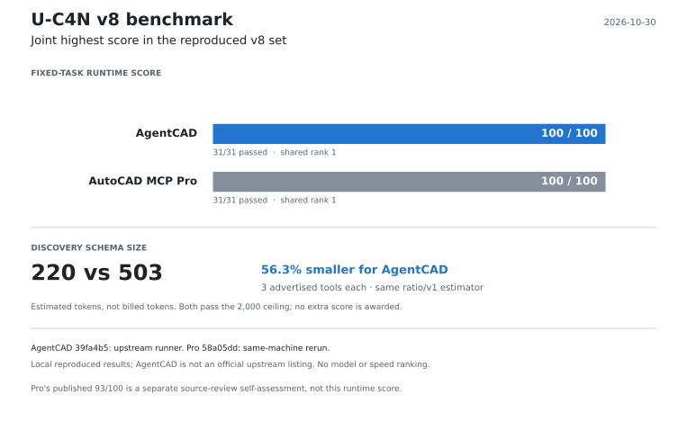
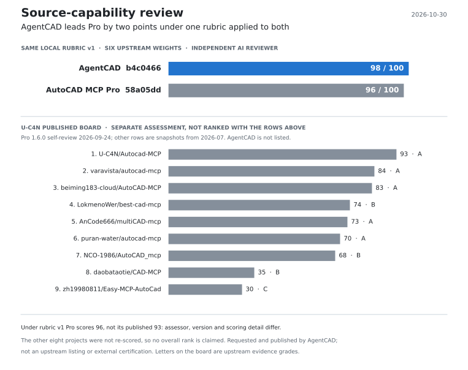

# Benchmarks

Every benchmark and comparison AgentCAD has run, with what it compares, its caveats and links to the full reports, logs and graders. The [README](../README.md#results-at-a-glance) keeps one line per benchmark.

The first three sections were moved from the README as of `0b93e9b`, with three more README passages: the paragraph that ends the AutoCAD MCP benchmark section (from "What's inside"), and the first seven rows of the report table and the note below it (from "Documentation"). Their text, numbers, dates, commit pins and caveats are unchanged; only the first heading (it was "Results") and the relative links, which now resolve from this folder, differ.

## Timed trials and BenchCAD Vision2Code

  <picture>
    <source media="(prefers-color-scheme: dark)" srcset="assets/results/results-dark.svg">
    
  </picture>

Every comparison keeps the agent and model the same and changes only the tools.

- **Faster.** On most tasks, runs were 1.4–3× faster than the same agent writing ezdxf code. They were 1.7–1.9× faster than the same agent using AutoCAD MCP Pro, including with AutoCAD 2027 open.
- **Undo that survives a new session.** In a five-round revision, AgentCAD restored an earlier hole size from its journal 3/3 times. With AutoCAD MCP Pro the agent could not, 0/3.
- **3D from pictures.** On 100 [BenchCAD](https://arxiv.org/abs/2605.10865) Vision2Code tasks, Claude Code rebuilt parts from four views more accurately through AgentCAD than by writing CadQuery itself: mean IoU 0.745 vs 0.682. Through AgentCAD it still wrote CadQuery, but each script ran as a checked transaction, and it could compare its part with the target and get a match score that also checks the edges inside the outline. This is our own run, not the BenchCAD leaderboard, where models write CadQuery in one shot.
- **Where it doesn't win yet:** Codex still rebuilt those parts more accurately by writing CadQuery itself (0.918 vs 0.876), though through AgentCAD it took a third less time. For a batch of near-identical drawings, one generated script is faster and cheaper. AgentCAD sessions also read about 2× the input tokens.

Samples are small (2–3 runs per task, one run per BenchCAD task). The full reports with logs and graders:
- [vs. writing code, Claude Code](comparison-claude-code.md)
- [vs. writing code, Codex](comparison-hard-tasks.md)
- [vs. AutoCAD MCP Pro](comparison-autocad-mcp-pro.md)
- [native DWG in AutoCAD 2027](comparison-native-dwg.md)
- [BenchCAD](../examples/benchcad/README.md)
- [BenchCAD 2: nine public development samples, GPT-6.1 Sol max (snapshot `2583516`)](../examples/benchcad2/report-2026-10-30.md)
- [Parametric CAD Bench V3 pilot: six tasks with native PartDesign operations](../examples/parametric_cad_bench/README.md)

## AutoCAD MCP benchmark

Latest repaired-source rerun, 2026-10-31: AgentCAD `290ced3` again passed **31/31**
locally and in Linux CI using the same unchanged upstream evaluator.
[New raw report](../examples/source_capability/results/2026-10-31-recheck/v8-report.json)
and [source/environment evidence](source-capability-recheck.md#verification-and-production-evidence)
are retained separately from the original comparison below.

**100/100 on U-C4N's v8 runtime matrix: 31/31 tasks passed, tied with AutoCAD MCP Pro.** Checked on 2026-10-30: AgentCAD `39fa4b5` and Pro `58a05dd`, using matrix v8 / evaluator v8.1. AgentCAD's run uses the upstream runner and its public MCP interface; the reference was also rerun on this machine.

  <picture>
    <source media="(prefers-color-scheme: dark)" srcset="assets/mcp-benchmark/leaderboard-dark.svg">
    
  </picture>

This is a fixed-task capability benchmark, without an LLM. It is not a speed or same-model success-rate ranking. AgentCAD's estimated discovery schema is **56.3% smaller** (220 vs. 503 tokens); both pass the 2,000-token ceiling, so this earns no extra score.

Pro's **93/100** chart is a separate, upstream-authored **source-review self-assessment** of version 1.6.0. This chart uses the 31-task execution matrix instead. The [historical scoring explanation](benchmark-leaderboard.md) and [new source-capability review](source-capability-review.md) keep the measures and product versions separate.

[Results and pinned sources](assets/mcp-benchmark/data.json) · [31-task report](../examples/autocad_benchmark/results/2026-10-30-v8/upstream/agentcad.json) · [Reproduce and inspect the evidence](../examples/autocad_benchmark/README.md) · [Upstream submission](https://github.com/U-C4N/Autocad-MCP/pull/15) (pending review)

The fixed [U-C4N v8 execution matrix](comparison-upstream-benchmark-v8.md) now passes 31/31 through AgentCAD's native MCP workflows, tying the locally rerun reference. This is independent local evidence, not an official leaderboard listing.

## Source-capability comparison

**Repaired-source assessment, 2026-10-31: AgentCAD 100/100 · AutoCAD MCP Pro 93/100.**
The same frozen rubric v1 applies to AgentCAD `290ced3` and Pro `58a05dd`.
M14's nominal dimensions have checked references; mechanical manufacturing
annotations and visible dimension verification have saved-output/native evidence.
The repaired source was independently reassessed after the earlier 6699109 score
was invalidated; its original record is retained below.

| Category | Weight | AgentCAD | AutoCAD MCP Pro |
|---|---:|---:|---:|
| Functional CAD coverage | 25 | 25 | 24 |
| Correctness and delivery | 20 | 20 | 17 |
| Backends and platforms | 15 | 15 | 15 |
| Engineering production | 15 | 15 | 15 |
| Tests and maintenance | 15 | 15 | 14 |
| Security and operations | 10 | 10 | 8 |
| **Total** | **100** | **100** | **93** |

  <picture>
    <source media="(prefers-color-scheme: dark)" srcset="assets/source-capability/board-dark.svg">
    
  </picture>

Verification: **885 passed / 8 skipped** with AutoCAD/FreeCAD,
four completed CI lanes, original v8 **31/31**, seven inspected PDFs and 24
correctness-checked performance observations. This is a local comparison of two
pinned sources, not an official overall ranking. Pro's historical self-review
93 remains separate. [Full review and limits](source-capability-recheck.md) ·
[Reproduce / inspect evidence](../examples/source_capability/results/2026-10-31-recheck/README.md).

Superseded 6699109 assessment and earlier historical records (preserved)

**Follow-up under recheck:** the final publication review found transparent-text
and scientific-notation false successes. The `6699109` 100/93 assessment below is
retained as a superseded review, not a valid current score; C2 is capped at 2 until
repair and retest. [Correction notice](source-capability-manufacturing-review.md).

**Latest follow-up, 2026-10-31: AgentCAD 100/100 · AutoCAD MCP Pro 93/100.**
The same frozen rubric v1 applies to AgentCAD `6699109` and Pro `58a05dd`.
M14 nominal-source verification and manufacturing annotations now have independent
evidence. Further symmetric tests exposed a previously missed false success in
both products; AgentCAD fixes it, while Pro's same pinned source loses three C2
points. Its new local 93 and historical self-review 93 are separate assessments.

| Category | Weight | AgentCAD | AutoCAD MCP Pro |
|---|---:|---:|---:|
| Functional CAD coverage | 25 | 25 | 24 |
| Correctness and delivery | 20 | 20 | 17 |
| Backends and platforms | 15 | 15 | 15 |
| Engineering production | 15 | 15 | 15 |
| Tests and maintenance | 15 | 15 | 14 |
| Security and operations | 10 | 10 | 8 |
| **Total** | **100** | **100** | **93** |

Verification: **815 passed / 8 skipped** with native AutoCAD/FreeCAD,
four completed CI lanes, original v8 **31/31**, seven inspected PDF outputs and
24 correctness-checked version-performance observations. This is a local comparison
of these two pinned products, not an official overall leaderboard or manufacturing
certificate. [Review and limits](source-capability-manufacturing-review.md) ·
[Reproduce / inspect the archive](../examples/source_capability/results/2026-10-31/README.md).

Historical assessment and chart, 2026-10-30: 98 / 96 (unchanged)

**AgentCAD 98/100 · AutoCAD MCP Pro 96/100**, under the same frozen local rubric, reviewed on 2026-10-30. This uses the six categories and weights from Pro's source-capability chart, with 20 published scoring items applied to both pinned products. A separate AI reviewer assessed the source, counterexamples, saved outputs and test evidence; AgentCAD requested and publishes this review.

| Source capability | Weight | AgentCAD `b4c0466` | MCP Pro `58a05dd` |
|---|---:|---:|---:|
| Functional coverage | 25 | 25 | 24 |
| Correctness and delivery | 20 | 20 | 20 |
| Backends and platforms | 15 | 15 | 15 |
| Engineering production | 15 | 13 | 15 |
| Tests and maintenance | 15 | 15 | 14 |
| Security and operations | 10 | 10 | 8 |
| **Total** | **100** | **98** | **96** |

  <picture>
    <source media="(prefers-color-scheme: dark)" srcset="assets/source-capability/source-capability-dark.svg">
    
  </picture>

Pro's original **93/100** is its **v1.6.0 self-review from 2026-09-24**, using less detailed scoring anchors. It remains a separate historical result. The comparison above establishes a two-point lead under our published local method; it is **not an official upstream ranking or external certification**.

The work repaired strict delivery checks, native tolerances, curved-pipe connectivity, HTTP defaults and process locks, and added sourced dimensional data, locked dependencies and cross-platform CI. Final verification: **685 passed / 8 skipped** locally with AutoCAD and FreeCAD enabled; four completed CI lanes; **31/31** again on the original v8 matrix. Skips are not passes. AgentCAD still loses two points: unverified M14 counterbore data and incomplete automatic manufacturing annotation in the mechanical template.

[Scores, deductions and scope](source-capability-review.md) · [Frozen rubric](source-capability-rubric.md) · [Item-by-item assessment](../examples/source_capability/results/2026-10-30/assessment.json) · [Reproduce / retained evidence](../examples/source_capability/README.md)

## BenchCAD 2 development samples

**9/9 explicit submissions, 53.45/100 mean of the six task means.** Codex CLI with GPT-6.1 Sol at reasoning effort max ran BenchCAD 2's nine public development samples, covering all six tasks, through AgentCAD snapshot `2583516` and BenchCAD `v2.1`, on 2026-10-30. This is a custom MCP agent harness, not BenchCAD's provider harness, the gated 100-case Core set or a leaderboard result. The development samples check integration and are too small to estimate general performance.

**Controlled Astra / Sol replay: GPT-6 Astra / max 56.79 vs Sol / max 53.45** on the original nine first attempts, with the same `2583516` snapshot, prompts, inputs and 3,600-second / 100-call per-case limits. Astra submitted 8/9: T6/case2 ended with connection/request errors and no answer, so the predefined no-submission rule assigns zero. One additional infrastructure recovery also failed and is reported separately, without replacing the first-attempt results. T1–T5 task means are 58.15 vs 44.26.

| Task | Samples | Sol / 100 | Astra / 100 |
|---|---:|---:|---:|
| T1 part from an engineering drawing | 1 | 78.22 | 71.64 |
| T2 assembly from supplied parts | 2 | 11.79 | 53.51 |
| T3 part from four views | 2 | 58.46 | 59.11 |
| T4 parts and assembly from views | 1 | 13.69 | 16.22 |
| T5 assembly from drawn and supplied parts | 1 | 59.16 | 90.26 |
| T6 connection graph from PCB photos (model only) | 2 | 99.40 | 50.00 |
| **Mean of the six task means** | **9** | **53.45** | **56.79** |

T2 tests assembly reasoning with supplied parts, and AgentCAD has no native assembly engine; T6 is model-only visual graph reasoning, and AgentCAD has no schematic engine. The six-task aggregate is therefore not AgentCAD CAD-engine performance alone. Both runs are development-sample results, not Core rankings.

[Summary and protocol](../examples/benchcad2/README.md) · [Sol report (Chinese)](../examples/benchcad2/report-2026-10-30.md) · [Sol metrics and provenance](../examples/benchcad2/results-2026-10-30.json) · [Astra / Sol report (Chinese)](../examples/benchcad2/comparison-astra-sol-2026-10-30.md) · [Comparison and provenance](../examples/benchcad2/comparison-astra-sol-2026-10-30.json) · [Astra first nine](../examples/benchcad2/results-astra-first-attempts-2026-10-30.json) · [Astra all attempts](../examples/benchcad2/results-astra-2026-10-30.json)

**Native-tool control, 2026-10-31: AgentCAD 56.79 vs BenchCAD native tools 71.77**, both with GPT-6 Astra / max, the same nine cases, Codex CLI 0.163.0 and 3,600-second / 100-call per-case caps. The original AgentCAD first attempts remain the reference; all eight valid sealed answers were regraded in the same frozen environment as the native answers, with no score changes. Nine fresh standard-answer checks passed. Native submitted 9/9; its T6/case2 scored 94.94 against the reference's connection-failure/no-submission zero. That delivery difference is not a CAD-engine gain.

The prespecified T1–T5 mean is **AgentCAD 58.15 vs native 66.63**. All five task means favor native in this run, although AgentCAD wins T2/case1 (38.74 vs 17.33). The T1/T3 part-geometry group is 65.38 vs 81.67; the T2/T4/T5 assembly-workflow group is 53.33 vs 56.60. No AgentCAD net gain was observed on these samples. This compares complete workflows: native calls execute whole Python programs, tool instructions differ, and the aligned Python/CadQuery native runtime uses Linux Docker with 2 GiB / one CPU. It does not isolate one kernel component or establish general ranking. Historical Sol/Astra measurements above remain unchanged.

[Native comparison report (Chinese)](../examples/benchcad2/comparison-native-astra-2026-10-31.md) · [Paired metrics and provenance](../examples/benchcad2/comparison-native-astra-2026-10-31.json) · [Native nine first attempts](../examples/benchcad2/results-native-astra-2026-10-31.json) · [Control design and reproduction](../examples/benchcad2/native-control.md)

## Parametric CAD Bench V3 pilot

**6/6 tasks submitted valid editable parts; mean task reward 55.43/100.** Codex with gpt-6.1-sol built native PartDesign parts through AgentCAD for six fixed tasks from [Parametric CAD Bench V3](https://cadbench.ai/benchmark): two creation, two create-and-edit and two drawing-reconstruction tasks, sampled with seed 42. It is a local integration experiment with a shorter time budget and a different FreeCAD build, not an official leaderboard submission; the six-task mean does not estimate the 100-task leaderboard reliably.

Later iterations on the two drawing tasks are kept as separate records: a diagnosis-and-regression iteration scored a 50.43 two-task mean, a face-measurement iteration 48.83 and a dimension-endpoint iteration 67.05. These known-task results do not establish reliability on unseen drawings or change the original pilot mean. Four previously unrun drawings then scored 11.64, 58.65, 99.83 and 15.66, a 46.45 mean; without an older-version run on the same four tasks, this does not measure a causal improvement.

[Adapter, protocol and all iterations](../examples/parametric_cad_bench/README.md) · [Pilot report](../examples/parametric_cad_bench/pilot-2026-10-30.md) · [Unseen drawings](../examples/parametric_cad_bench/unseen-drawings-2026-10-30.md)

## All reports

| | |
|---|---|
| [examples/benchcad/README.md](../examples/benchcad/README.md) | BenchCAD Vision2Code pilot: 3D parts from images, Claude Code vs. Codex |
| [docs/comparison-claude-code.md](comparison-claude-code.md) | Claude Code: AgentCAD vs. writing code, before and after the compact catalog |
| [docs/comparison-hard-tasks.md](comparison-hard-tasks.md), [docs/comparison-code-vs-agentcad.md](comparison-code-vs-agentcad.md) | Codex: the same comparison |
| [docs/comparison-autocad-mcp-pro.md](comparison-autocad-mcp-pro.md) | Codex: AgentCAD vs. AutoCAD MCP Pro on the same tasks, plus fault injection |
| [docs/comparison-native-dwg.md](comparison-native-dwg.md) | Native DWG with AutoCAD 2027 open: AgentCAD vs. AutoCAD MCP Pro |
| [docs/trials-report.md](trials-report.md) | Classic drafting tasks and 96 real AutoCAD sample drawings |
| [docs/acceptance-report.md](acceptance-report.md) | Acceptance tests and evidence |
| [docs/comparison-upstream-benchmark-v8.md](comparison-upstream-benchmark-v8.md) | U-C4N v8 execution matrix: AgentCAD 31/31, including the final rerun after independent review |
| [docs/comparison-upstream-benchmark.md](comparison-upstream-benchmark.md) | The earlier U-C4N run, before that work: v2 7/10, v8 9/31 (kept as recorded) |
| [docs/benchmark-leaderboard.md](benchmark-leaderboard.md) | Historical scoring explanation: sources and limits of the v8 chart and of the published source-review board |
| [docs/source-capability-review.md](source-capability-review.md) | Six-category source-capability review: scores, deductions, verification and scope |

Run logs and graded results for the experiments are in `examples/trials/` and `examples/benchcad/`. Logs of the tasks that use Autodesk sample drawings (T7, H2) are not published, because the drawings are not ours to redistribute.
