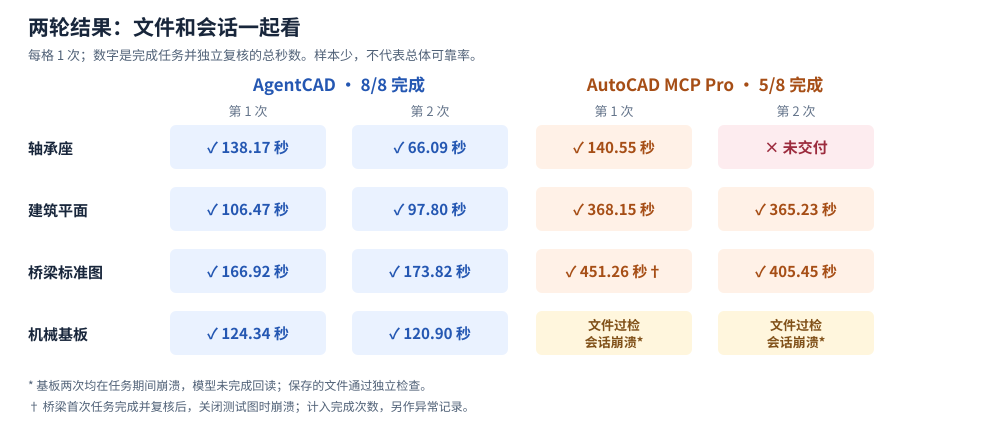
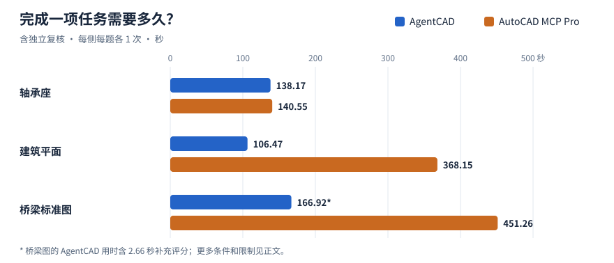

# 原生 DWG 实机实验：AgentCAD 与 AutoCAD MCP Pro

2026-10-29 · Windows · AutoCAD 2027 中文教育版 · 四张图，每题每侧各 2 次

**两轮结果：**按“模型完成任务、自检无未完成项，交付文件通过独立检查”计，AgentCAD **8/8**，Pro **5/8**。Pro 一次未交付；基板两次保存的文件均通过独立检查，但会话内 AutoCAD 崩溃，模型自己的回读核验未完成。样本量仅为每题两次，不能外推总体可靠率。

表中数字是模型任务与独立复核的总秒数，只对完整完成的任务作效率比较。Pro 的两次基板结果列出故障状态，不把失败流程耗时当作成功交付时间。

| 图纸与轮次 | AgentCAD | Pro |
|---|---:|---:|
| 轴承座第 1 / 2 次 | 138.17 / 66.09 秒 | 140.55 秒 / 未交付 |
| 建筑平面第 1 / 2 次 | 106.47 / 97.80 秒 | 368.15 / 365.23 秒 |
| 桥梁标准第 1 / 2 次 | 166.92 / 173.82 秒 | 451.26 / 405.45 秒 |
| 机械基板第 1 / 2 次 | 124.34 / 120.90 秒 | 两次文件过检，均在会话内崩溃 |

轴承座 Pro 第 2 次的模型报告 CAD 服务不可用，未操作图纸；原因未确认，计为未交付。随后单独做的恢复重试保存了通过检查的文件，但 AutoCAD 在模型回读时崩溃；这次重试不替代正式结果。基板 Pro 两次分别花费 457.12 和 435.36 秒执行、6.61 和 6.99 秒独立复核，保存文件均通过覆盖的检查，但模型均报告回读未完成。桥梁 Pro 第 1 次在任务完成并复核**后**关闭测试图时崩溃；它计入上表的完成次数，清理阶段崩溃仍作为异常记录。

补跑使用与初次相同的 AgentCAD `f7de09a4` 源码、Pro `58a05ddf`、模型、底图和任务；第 2 轮先运行 Pro，减少固定顺序的影响。后来对 AgentCAD 主线 `409c670` 复核实时编辑：两张打开的 DXF 均返回 `FILE_BUSY`，原文件未变；关闭后同样操作成功。提示更明确，但此环境下的实时编辑仍未跑通。

## 首轮阶段记录

以下为先前发布的阶段记录，保留原数据和限制。

展开首轮图表、方法与底图哈希

2026-10-29 · Windows · AutoCAD 2027 中文教育版 · 每项任务每侧各 1 次

**实验观察：**三组已完成的同条件任务都通过了本轮检查。轴承座耗时接近；建筑平面和桥梁图上，AgentCAD 在本次运行中更快。样本很少，且还有单独记录的故障，不能据此推断总体可靠率或速度。

| 同一图纸与任务 | AgentCAD：任务 + 复核 | Pro：任务 + 复核 | 检查结果 |
|---|---:|---:|---|
| 轴承座：修改模型与布局中的孔 | 128.75 + 9.42 = **138.17 秒** | 132.58 + 7.97 = **140.55 秒** | 两侧通过 |
| 建筑平面：替换两处文字并加注释 | 98.73 + 7.74 = **106.47 秒** | 359.65 + 8.50 = **368.15 秒** | 两侧通过 |
| 桥梁标准图：补充两处文字并加测试注释 | 155.50 + 8.76 + 2.66 = **166.92 秒** | 441.91 + 9.35 = **451.26 秒** | 两侧通过 |

任务时间包括导入、修改和保存；复核时间包括 AutoCAD 重新打开、AUDIT 和回读比较。桥梁图的 AgentCAD 多计入 **2.66 秒**补充评分；Pro 的复核已包含相应检查。AutoCAD GUI 预先启动，启动时间未计入。失败或未完成任务的耗时不作为成功交付时间比较。

## 哪些问题需要关注？

| 观察 | 本次证据与范围 |
|---|---|
| **实时编辑文件锁** | AgentCAD `f7de09a4` 和后来带重试的 `8281216`，在 AutoCAD 打开 DXF 时对两张图的修改均遇到 Windows 文件替换错误；关闭测试副本后同样操作成功，失败时原文件未变。`pull` 未测；`8281216` 之后的主线变更未在此实验复核。 |
| **AutoCAD 崩溃** | 一次基板 Pro 会话期间，以及桥梁 Pro 结果交付后的关闭测试图纸过程中，Windows 分别记录 GUI 崩溃（`0xc0000374`）。根因未知；桥梁交付文件在崩溃前已独立打开并通过检查。 |
| **输出格式变化** | 桥梁原图为 DWG 2018（`AC1032`），Pro 输出为 DWG 2000（`AC1015`）。输出能被 AutoCAD 重新打开且 AUDIT 零错误，但本实验未验证所有新版特性。 |
| **未交付的补充试验** | 另一轮基板任务中，Pro 会话发送了括号不完整的 AutoLISP，随后等待输入并超时，未交付；AgentCAD 完成并通过。该轮 GUI 起始状态与上表不同，不与上表混算，也不能单独把失败归因于某一产品。 |

机械基板的更早试运行中，两侧也都通过检查：AgentCAD **180.48 秒**，Pro **521.97 秒**。当时 AgentCAD 脚本关闭、Pro 可以使用 AutoLISP，配置不同，故不与上表混算。模型服务容量中断和检测到其他 AutoCAD 测试的尝试均保留为中断记录，不计成功或失败。

## 怎么测试和复核？

- **同一输入与模型：**每侧使用原生 DWG 的逐字节副本、同一任务、Codex CLI 0.163.0 和 `gpt-6.1-sol`（high）；依次运行，不覆盖原图。AgentCAD 提交 `f7de09a492465110e4b645726f2bd4a4c81490f0`；Pro 1.7.0，提交 `58a05ddfc34a9832c626e82cd88ecdce8e16a62a`。
- **不同工作流：**AgentCAD 使用 AutoCAD Core Console 导入、导出 DWG，中间编辑 DXF；Pro 使用运行中的 AutoCAD GUI 和 COM。两侧均允许各自 CAD 服务的脚本，但语言和能力不同；不允许操作系统命令或其他插件。
- **图纸：**轴承座、建筑平面和补充试验基板为 AutoCAD 自带样例；桥梁图为 [Harris County 公开的桥面排水标准参考图](https://oce.harriscountytx.gov/Services/Consultants-Resources-and-Specifications/Standards-Specification/Standard-Bridge-Drawings)，原图约 5,654 个实体。这些不是具体生产订单的施工交付图。
- **检查：**用 AutoCAD 重新打开交付 DWG 并运行 AUDIT；核对源文件哈希、单位、布局、目标文字和几何，以及部分其他对象和块。桥梁图还比较了匿名块的部分内容；评分器用漏改文字、移动直线、损坏块和丢失文件名字段的反例做过检查。针对基板与桥梁的两处初始误报分别修正后重评，原记录保留。

任务的关键要求如下，未提及的对象按原样保留：

| 图纸 | 具体修改 |
|---|---|
| 轴承座 | 模型空间与 `Bearing Block_Slide` 布局各 4 个 Ø5 孔改为 Ø5.5，孔心不变；模型空间 `(50, 0)` 添加高度 4 的 `REV B: 4X D5.5`。 |
| 建筑平面 | 模型空间两条 `PRINTER ISLAND` 改为 `PRINT AREA`，保留位置、角度、高度和图层；在 `(736, 650)` 的 `REV_NOTES` 图层添加高度 12 的 `REV B: PRINT AREA RENAMED`。 |
| 桥梁标准 | 两条 `SPLIT 6" PVC` 改为 `SPLIT 6" PVC SCH 40`，保留位置、角度、高度和图层；在 `(2147490, 2147484)` 的 `EVAL_NOTES` 图层添加高度 0.12 的 `EVAL ONLY - NOT FOR CONSTRUCTION`。 |
| 机械基板 | 模型空间与 `Base Plate` 布局的 Ø10.2 孔改 Ø10.5、Ø25 孔改 Ø26，布局按 0.325 倍缩放；两处各给两个 Ø40 孔加真实直径标注，并在模型零件下方添加高度 5 的 `REV B: Ø10.2→Ø10.5, Ø25→Ø26`。 |

**局限：**坐标等部分数值按小数点后三位比较；未知实体、部分属性、外部参照、标注关联和视觉排版没有完整覆盖。AUDIT 为零不代表图纸满足工程要求。每组仅一次、起始顺序也未完成重复，不能据此计算可靠率。原始 Autodesk 图纸、派生文件和逐次日志保存在实测机器，不随仓库发布。

输入文件与 SHA-256

| 图纸 | 文件 | SHA-256 |
|---|---|---|
| 基板 | `VW252-02-0142.dwg` | `5852f8d05e69921cb758e420ff89ab6a57a8d3ed6d563e6c81dbd738f5066bd7` |
| 轴承座 | `VW252-02-1000.dwg` | `30332bc54795e88968bfd642fe695d579d5792bbd839618de7a74a609b4b02dd` |
| 建筑平面 | `Floor Plan Sample.dwg` | `19270c23e56e407aab2ade3644e8f301c34e390638d99c3f0cc4f2d3a6516792` |
| 桥梁标准 | `DR_23.10.10.dwg` | `715738bf440fd95d0b4060e6bb986901df380745e33a4269f1609f620fa36229` |

