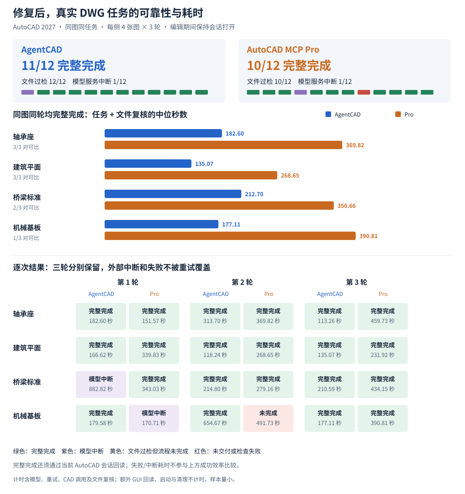
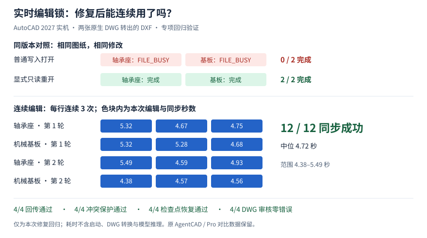

# 原生 DWG 实机实验：AgentCAD 与 AutoCAD MCP Pro

## 修复后：三轮实机对照

2026-10-29 · AutoCAD 2027 中文教育版 · 同一组四张原生 DWG、同一几何任务 · 每侧每题各 3 次

**完整完成：AgentCAD 11/12，Pro 10/12；文件通过检查：12/12 与 10/12。**模型服务中断分别为 1 次、1 次，均保留在分母和逐次记录中，不能单凭这些中断推断 CAD 产品的可靠性。

“完整完成”要求模型会话正常结束、原图未覆盖、交付 DWG 通过任务文件检查，且当前 AutoCAD 文档与交付文件的回读结果一致。AgentCAD 还须先打开工作 DXF 再编辑，且实际自动同步成功。本轮 24 份 DWG 的 AUDIT 均为零错误，但有 2 份未满足任务要求；格式可读、任务正确和会话完成分开判断。

| 同图同轮均完整成功 | 可比配对数 | AgentCAD 中位耗时 | Pro 中位耗时 |
|---|---:|---:|---:|
| 轴承座 | 3/3 | 182.60 秒 | 369.82 秒 |
| 建筑平面 | 3/3 | 135.07 秒 | 268.65 秒 |
| 桥梁标准 | 2/3 | 212.70 秒 | 356.66 秒 |
| 机械基板 | 1/3 | 177.11 秒 | 390.81 秒 |

耗时为“模型任务 + 独立文件复核”，包含模型重试、CAD 服务调用、DWG 导入/导出与 AUDIT；额外的监督程序 GUI 回读、GUI 启动和清理不计时。中断或未完成尝试的耗时只在逐次图表中展示，不参与成功配对的效率比较。

基板 AgentCAD 第 2 轮虽成功，但耗时达 **654.67 秒**；因对应 Pro 样本未通过任务检查，它未进入上方配对表。逐次图仍保留该值，不能用条件筛选后的中位数代替全部尝试的效率。

### 失败与恢复证据

| 观察 | 本轮证据 |
|---|---|
| 模型容量或连接中断 | AgentCAD 1 次、Pro 1 次；服务错误与 CAD 输出结果分开记录。 |
| 非目标对象变化 | Pro 基板第 2 轮的纸空间多出 1 个无关大圆，尽管模型会话正常结束、AUDIT 零错误，仍未通过任务检查。该圆参数与同次缩放命令参数一致，疑似命令上下文问题，内部机制尚未确认。 |
| AgentCAD 工具层错误 | 实时接口不接受 DWG 10 次；请求未注册操作 3 次；脚本执行失败 2 次；请求的文件尚不存在 2 次。部分尝试后续恢复，任务按最终状态计。 |
| Pro 工具层错误 | 工具调用失败，未提供结构化错误码 2 次；LISP 被默认策略拒绝 16 次；打开图纸时读取文件名失败（Open.FullName） 1 次。部分尝试后续恢复，任务按最终状态计。 |
| 实时编辑文件锁 | AgentCAD 共记录 12 次尝试中的 12 次自动同步，12 次成功；`FILE_BUSY` 0 次。 |
| AutoCAD 崩溃 | 本轮 Windows Application Error 记录到 0 次 AutoCAD 崩溃；仅按实际事件记录判断，不从一次工具失败推断崩溃。 |

Pro 的 `pro_lisp_policy_refusal` 表示默认 LISP 限制策略拒绝调用，不代表 AutoCAD 执行后出错；例如基板首轮在四次拒绝后遇到模型容量中断，交付未完成，无法把结果单独归因于其中一个因素。AgentCAD 的 `BAD_EXTENSION` 是模型尝试通过仅支持 DXF 的实时接口打开 DWG；是否随后恢复，仍看该次最终状态。

版本、配对方法、逐次数据与范围

- [逐次结果与方法清单（JSON）](assets/native-dwg-fixed-repeat-results.json)包含全部 24 次首次尝试、工具错误分类、原图哈希和运行环境。每次使用新工作副本、新模型进程和新 MCP 服务；串行运行，预先固定顺序，12 组配对中两侧各先运行 6 组。原始尝试不被重试替换。
- AgentCAD `1ddc6ef70be10d36ca56df03b61117ea79c29ae5` 的运行时代码与文件锁修复合并版本 `4e289b9` 相同；Pro 固定 `58a05ddfc34a9832c626e82cd88ecdce8e16a62a`（1.7.0）。模型为 `gpt-6.1-sol`（high），Codex CLI 0.163.0。
- 两侧均允许各自服务的 CAD 脚本或表达式，禁止操作系统命令与其他插件；Pro 保持默认受限 LISP 策略。AgentCAD 打开自动同步与 CAD 命令接口。语言、工具和默认策略并不相同。
- 两侧均为 Python 3.11.16、pywin32 312；AgentCAD 使用 ezdxf 1.4.5 / mcp 1.30.0，Pro 使用 ezdxf 1.4.4 / mcp 1.29.0 / fastmcp 3.4.5。本轮固定各自依赖，比较实际安装工作流，无法只把表现差异归因于文件锁修复。
- 图纸与几何修改沿用下方历史任务。本轮额外要求编辑时保持 AutoCAD 会话打开并在交付后回读；AgentCAD 经 Core Console 把原生 DWG 转为 DXF，GUI 中编辑同步后再导出 DWG，Pro 通过 COM 编辑 DWG。新旧轮次的条件不同，数据单列，不能直接拼接或作单变量因果比较。
- 独立文件复核使用 AutoCAD 原生打开、AUDIT、DXF 回读，以及既有中立评分器的几何、文字、布局、部分非目标对象和块检查；额外 COM 回读将当前任务文档的布局实体数及目标文字/孔径与独立打开的交付文件比较，任务要求由文件评分器另行判断。它不覆盖所有未知属性、动态块行为、标注关联或视觉排版，也不代表具体生产订单的完整验收。
- 每图仅三轮，不能推断总体可靠率。源 DWG、派生文件和含实体数据的完整日志只保存在实测机器；实验报告、图表与汇总数据不进入 Git 源码下载归档或 Python 分发包。
- 仓库完整回归为 **285 通过、54 跳过**；源码分发包和 wheel 构建成功，并核对报告、图表与测量 JSON 均未打包。新报告生成时逐项核对全部 24 次计时、原图哈希和旧报告正文保留情况。

## 历史记录（保留原测量）

2026-10-29 · Windows · AutoCAD 2027 中文教育版 · 四张图，每题每侧各 2 次

**后续更新：**实时编辑文件锁已完成专项修复与实机复核，见[修复结果](#实时编辑文件锁修复复核)。下面的 AgentCAD / Pro 原始比较数据保留。

**两轮结果：**按“模型完成任务、自检无未完成项，交付文件通过独立检查”计，AgentCAD **8/8**，Pro **5/8**。Pro 一次未交付；基板两次保存的文件均通过独立检查，但会话内 AutoCAD 崩溃，模型自己的回读核验未完成。样本量仅为每题两次，不能外推总体可靠率。

表中数字是模型任务与独立复核的总秒数，只对完整完成的任务作效率比较。Pro 的两次基板结果列出故障状态，不把失败流程耗时当作成功交付时间。

| 图纸与轮次 | AgentCAD | Pro |
|---|---:|---:|
| 轴承座第 1 / 2 次 | 138.17 / 66.09 秒 | 140.55 秒 / 未交付 |
| 建筑平面第 1 / 2 次 | 106.47 / 97.80 秒 | 368.15 / 365.23 秒 |
| 桥梁标准第 1 / 2 次 | 166.92 / 173.82 秒 | 451.26 / 405.45 秒 |
| 机械基板第 1 / 2 次 | 124.34 / 120.90 秒 | 两次文件过检，均在会话内崩溃 |

轴承座 Pro 第 2 次的模型报告 CAD 服务不可用，未操作图纸；原因未确认，计为未交付。随后单独做的恢复重试保存了通过检查的文件，但 AutoCAD 在模型回读时崩溃；这次重试不替代正式结果。基板 Pro 两次分别花费 457.12 和 435.36 秒执行、6.61 和 6.99 秒独立复核，保存文件均通过覆盖的检查，但模型均报告回读未完成。桥梁 Pro 第 1 次在任务完成并复核**后**关闭测试图时崩溃；它计入上表的完成次数，清理阶段崩溃仍作为异常记录。

补跑使用与初次相同的 AgentCAD `f7de09a4` 源码、Pro `58a05ddf`、模型、底图和任务；第 2 轮先运行 Pro，减少固定顺序的影响。后来对 AgentCAD 主线 `409c670` 复核实时编辑：两张打开的 DXF 均返回 `FILE_BUSY`，原文件未变；关闭后同样操作成功。提示更明确，但此环境下的实时编辑仍未跑通。

## 实时编辑文件锁修复复核

2026-10-29 · 同一台 AutoCAD 2027 · 轴承座、机械基板各 2 轮 · 修复完成后的回归验证

**本次结果：12/12 次连续编辑与自动同步成功，中位耗时 4.72 秒。**四套完整流程均通过 AutoCAD 编辑回传、冲突保护、检查点恢复；导出的四个 DWG 均可回读，AUDIT 零错误。这是修复验证，没有重跑模型或 Pro，不改变上面的比较结果。

| 验证项目 | 实机结果 |
|---|---|
| 相同版本、相同修改的锁对照 | 两张图普通写入打开时均返回 `FILE_BUSY`，文件哈希未变；显式 `reload` 转为只读后，同样修改 **2/2 成功**。 |
| 连续修改并在 AutoCAD 中回读 | 每图每轮连续添加 3 条文字；磁盘与 AutoCAD 图元均核对，**12/12 成功**，每次 **4.38–5.49 秒**。 |
| AutoCAD 中的编辑回传 | 在实际 COM 文档中新增直线，`pull` 后核对文件、检查点和日志，**4/4 通过**。 |
| 未保存编辑与版本冲突 | AutoCAD 新增圆后由 AgentCAD 修改文件；自动重载保护 GUI 编辑，过期 `pull` 拒绝且文件哈希不变，**4/4 通过**。 |
| 显式覆盖与恢复 | `force` 回传保留 GUI 图元，被覆盖的 AgentCAD 版本留在检查点；`rollback` 恢复该版本并同步，**4/4 通过**。 |
| DWG 输出 | 四个结果导出为 DWG 2018（`AC1032`），经 AutoCAD 回读核对新增文字和直线，并运行 AUDIT，**4/4 零错误**。 |

**怎么使用：**由 `autocad_live open` 新打开的 DXF 改用只读方式，AgentCAD 可以替换文件，AutoCAD 仍可在内存中编辑，用 `pull` 提交。已经由用户以写入方式打开的图纸会保持原样；无须保留编辑时显式 `reload`，有编辑时先回传，未知版本仍需确认使用 `force`。

**为什么还要修视图：**实机中恢复视图会把 AutoCAD 标为未保存，`DBMOD` 为 16 或 24。修复只把普通二维、世界坐标系下的视图/窗口变化作为可重载状态；图元、图层、变量、字段或未知修改仍受保护。标记含义依据 [Autodesk DBMOD 文档](https://help.autodesk.com/cloudhelp/2025/ENU/AutoCAD-Core/files/GUID-E255E808-2D48-4BDE-A760-FFEA28E5A86F.htm)。

计时、数据与验证范围

- [逐次计时与检查结果（JSON）](assets/native-dwg-live-lock-results.json)记录四套回归流程、两次锁对照、DWG 复核及实测代码哈希。十二次计时是 `apply_operations` 请求的墙钟时间，包含校验与 COM 重载；不含 GUI 启动、DWG 转换、模型思考及随后独立的 GUI 回读。不能与上方完整模型任务用时直接比较。
- 使用前文列出的两张原生 DWG 经 AutoCAD 转出的 DXF 副本；两轮分别保留默认视图、先缩放再编辑，四次均核对中心与缩放。原生 DWG 和参考 DXF 的 SHA-256 均未变化。回传中的图元由实际 AutoCAD COM API 添加，不含人工鼠标操作评测。
- 调试阶段另保留四次未完成尝试：前两次验证脚本的 COM 会话失效，后两次分别暴露视窗标记 24 和纸空间适配问题，修正后才开始上述四套回归。这不是首次成功率，也不能估计总体可靠率。
- 代码回归：本分支完整测试 **285 通过、54 跳过**，新增 19 项回归用例覆盖只读打开、真实 Windows 文件共享锁、连续重载及未保存状态保护。
- 只测 AutoCAD 2027 和两张机械样例。视图恢复仅保留中心、缩放，不保证多视口、窗口位置或完整相机状态；非世界 UCS、旋转视图、透视和浮动模型视口的未保存状态继续拒绝自动重载。尚未验证其他版本、长期多人并发或原生 DWG 的直接实时编辑。
- 原始图纸、派生 DWG/DXF 与详细日志仅保留在实测机器；仓库仅收录报告、图表和汇总数据，均不随源码下载归档或 Python 分发包打包。

## 首轮阶段记录

以下为先前发布的阶段记录，保留原数据和限制。

展开首轮图表、方法与底图哈希

2026-10-29 · Windows · AutoCAD 2027 中文教育版 · 每项任务每侧各 1 次

**实验观察：**三组已完成的同条件任务都通过了本轮检查。轴承座耗时接近；建筑平面和桥梁图上，AgentCAD 在本次运行中更快。样本很少，且还有单独记录的故障，不能据此推断总体可靠率或速度。

| 同一图纸与任务 | AgentCAD：任务 + 复核 | Pro：任务 + 复核 | 检查结果 |
|---|---:|---:|---|
| 轴承座：修改模型与布局中的孔 | 128.75 + 9.42 = **138.17 秒** | 132.58 + 7.97 = **140.55 秒** | 两侧通过 |
| 建筑平面：替换两处文字并加注释 | 98.73 + 7.74 = **106.47 秒** | 359.65 + 8.50 = **368.15 秒** | 两侧通过 |
| 桥梁标准图：补充两处文字并加测试注释 | 155.50 + 8.76 + 2.66 = **166.92 秒** | 441.91 + 9.35 = **451.26 秒** | 两侧通过 |

任务时间包括导入、修改和保存；复核时间包括 AutoCAD 重新打开、AUDIT 和回读比较。桥梁图的 AgentCAD 多计入 **2.66 秒**补充评分；Pro 的复核已包含相应检查。AutoCAD GUI 预先启动，启动时间未计入。失败或未完成任务的耗时不作为成功交付时间比较。

## 哪些问题需要关注？

| 观察 | 本次证据与范围 |
|---|---|
| **实时编辑文件锁** | AgentCAD `f7de09a4` 和后来带重试的 `8281216`，在 AutoCAD 打开 DXF 时对两张图的修改均遇到 Windows 文件替换错误；关闭测试副本后同样操作成功，失败时原文件未变。`pull` 未测；`8281216` 之后的主线变更未在此实验复核。 |
| **AutoCAD 崩溃** | 一次基板 Pro 会话期间，以及桥梁 Pro 结果交付后的关闭测试图纸过程中，Windows 分别记录 GUI 崩溃（`0xc0000374`）。根因未知；桥梁交付文件在崩溃前已独立打开并通过检查。 |
| **输出格式变化** | 桥梁原图为 DWG 2018（`AC1032`），Pro 输出为 DWG 2000（`AC1015`）。输出能被 AutoCAD 重新打开且 AUDIT 零错误，但本实验未验证所有新版特性。 |
| **未交付的补充试验** | 另一轮基板任务中，Pro 会话发送了括号不完整的 AutoLISP，随后等待输入并超时，未交付；AgentCAD 完成并通过。该轮 GUI 起始状态与上表不同，不与上表混算，也不能单独把失败归因于某一产品。 |

机械基板的更早试运行中，两侧也都通过检查：AgentCAD **180.48 秒**，Pro **521.97 秒**。当时 AgentCAD 脚本关闭、Pro 可以使用 AutoLISP，配置不同，故不与上表混算。模型服务容量中断和检测到其他 AutoCAD 测试的尝试均保留为中断记录，不计成功或失败。

## 怎么测试和复核？

- **同一输入与模型：**每侧使用原生 DWG 的逐字节副本、同一任务、Codex CLI 0.163.0 和 `gpt-6.1-sol`（high）；依次运行，不覆盖原图。AgentCAD 提交 `f7de09a492465110e4b645726f2bd4a4c81490f0`；Pro 1.7.0，提交 `58a05ddfc34a9832c626e82cd88ecdce8e16a62a`。
- **不同工作流：**AgentCAD 使用 AutoCAD Core Console 导入、导出 DWG，中间编辑 DXF；Pro 使用运行中的 AutoCAD GUI 和 COM。两侧均允许各自 CAD 服务的脚本，但语言和能力不同；不允许操作系统命令或其他插件。
- **图纸：**轴承座、建筑平面和补充试验基板为 AutoCAD 自带样例；桥梁图为 [Harris County 公开的桥面排水标准参考图](https://oce.harriscountytx.gov/Services/Consultants-Resources-and-Specifications/Standards-Specification/Standard-Bridge-Drawings)，原图约 5,654 个实体。这些不是具体生产订单的施工交付图。
- **检查：**用 AutoCAD 重新打开交付 DWG 并运行 AUDIT；核对源文件哈希、单位、布局、目标文字和几何，以及部分其他对象和块。桥梁图还比较了匿名块的部分内容；评分器用漏改文字、移动直线、损坏块和丢失文件名字段的反例做过检查。针对基板与桥梁的两处初始误报分别修正后重评，原记录保留。

任务的关键要求如下，未提及的对象按原样保留：

| 图纸 | 具体修改 |
|---|---|
| 轴承座 | 模型空间与 `Bearing Block_Slide` 布局各 4 个 Ø5 孔改为 Ø5.5，孔心不变；模型空间 `(50, 0)` 添加高度 4 的 `REV B: 4X D5.5`。 |
| 建筑平面 | 模型空间两条 `PRINTER ISLAND` 改为 `PRINT AREA`，保留位置、角度、高度和图层；在 `(736, 650)` 的 `REV_NOTES` 图层添加高度 12 的 `REV B: PRINT AREA RENAMED`。 |
| 桥梁标准 | 两条 `SPLIT 6" PVC` 改为 `SPLIT 6" PVC SCH 40`，保留位置、角度、高度和图层；在 `(2147490, 2147484)` 的 `EVAL_NOTES` 图层添加高度 0.12 的 `EVAL ONLY - NOT FOR CONSTRUCTION`。 |
| 机械基板 | 模型空间与 `Base Plate` 布局的 Ø10.2 孔改 Ø10.5、Ø25 孔改 Ø26，布局按 0.325 倍缩放；两处各给两个 Ø40 孔加真实直径标注，并在模型零件下方添加高度 5 的 `REV B: Ø10.2→Ø10.5, Ø25→Ø26`。 |

**局限：**坐标等部分数值按小数点后三位比较；未知实体、部分属性、外部参照、标注关联和视觉排版没有完整覆盖。AUDIT 为零不代表图纸满足工程要求。每组仅一次、起始顺序也未完成重复，不能据此计算可靠率。原始 Autodesk 图纸、派生文件和逐次日志保存在实测机器，不随仓库发布。

输入文件与 SHA-256

| 图纸 | 文件 | SHA-256 |
|---|---|---|
| 基板 | `VW252-02-0142.dwg` | `5852f8d05e69921cb758e420ff89ab6a57a8d3ed6d563e6c81dbd738f5066bd7` |
| 轴承座 | `VW252-02-1000.dwg` | `30332bc54795e88968bfd642fe695d579d5792bbd839618de7a74a609b4b02dd` |
| 建筑平面 | `Floor Plan Sample.dwg` | `19270c23e56e407aab2ade3644e8f301c34e390638d99c3f0cc4f2d3a6516792` |
| 桥梁标准 | `DR_23.10.10.dwg` | `715738bf440fd95d0b4060e6bb986901df380745e33a4269f1609f620fa36229` |

