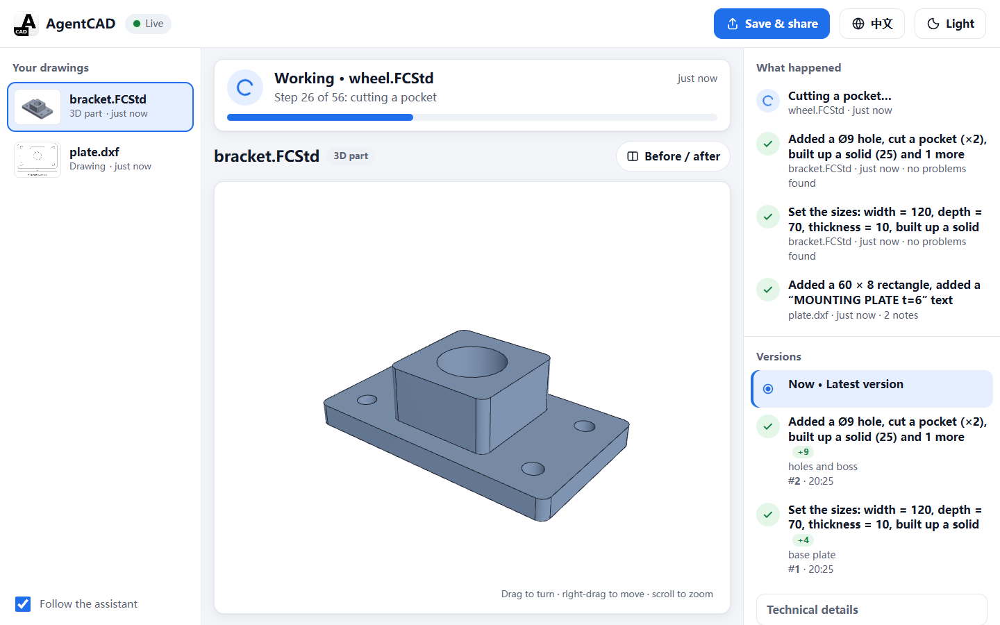
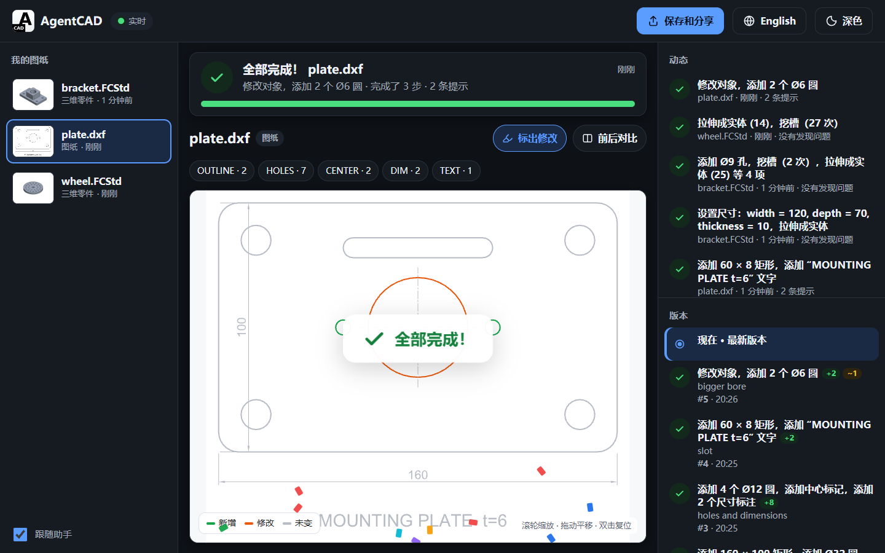
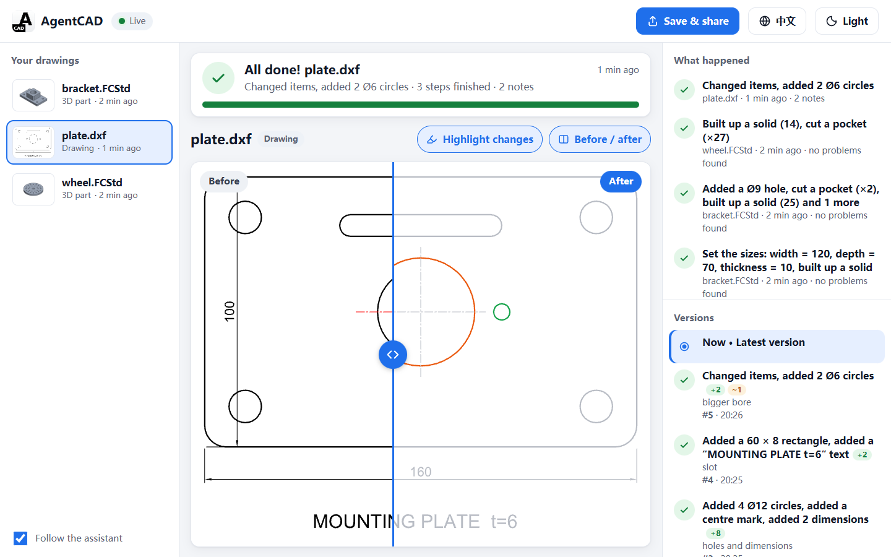

# 实时查看器（viewer）

Agent 改图纸或零件时，人可以在浏览器里实时看到它在变：正在做哪一步、做完了没有、有没有问题，还能把结果存成一个
网页或一张图片发给别人。查看器只读工作区，不依赖是哪个 Agent 在改（Claude Code、Codex、CLI、HTTP API 都一样）。



## 怎么打开

**通过 MCP 用 AgentCAD 时什么都不用做。** MCP 服务器在第一次创建或修改文件时，在后台启动查看器（同一个进程里的
后台线程，MCP 服务器退出它就退出）。之后每个改了文件的结果都带 `viewer_url`（如 `http://127.0.0.1:8770/#plate.dxf`），
MCP 的说明（instructions）要求 Agent 第一次改文件时把这个链接告诉用户。用户点开链接就能看。

- 端口：8770 起找空闲的（8770–8779，都占用就随便一个），`AGENTCAD_VIEWER_PORT` 可以指定。
- 同一个根目录已经有查看器在跑（另一个 Agent 的 MCP 服务器，或手动启动的），就用它，不再启动第二个。
- `AGENTCAD_VIEWER=0`：不自动启动（`viewer_url` 只在别处已有查看器时出现）。
- `AGENTCAD_VIEWER_OPEN=1`：启动时顺便在默认浏览器里打开。默认不弹窗。
- 自动启动只在 MCP 服务器里发生；CLI 和 Python API（`Runtime(policy)`）不会启动后台线程，`Runtime(policy, auto_viewer=True)` 可以打开。

也可以自己启动：

```bash
agentcad --root playground viewer            # http://127.0.0.1:8770/
agentcad --root playground viewer --port 9000
```

Windows 上是 `.venv\Scripts\agentcad.exe`。启动后打印一行 JSON（`{"ok": true, "viewer": "http://127.0.0.1:8770/", ...}`），
Ctrl+C 退出。端口被占用时返回 `PORT_IN_USE`，退出码 2。三维零件要用 FreeCAD 出网格，启动查看器的环境里同样要设
`AGENTCAD_FREECAD`（见 [part-3d.md](part-3d.md)）。

仓库带的 `.claude/launch.json` 里有 `agentcad-viewer` 配置，在 Claude 桌面应用的内置浏览器里启动查看器（根目录
`playground`，端口 8770）。它用的是 Windows venv 路径 `.venv/Scripts/python.exe`，macOS/Linux 改成 `.venv/bin/python`。

### 安全

只监听 `127.0.0.1`，并且只回应 Host 头是 `127.0.0.1`、`localhost` 或 `[::1]` 的请求（其他返回 403 `HOST_NOT_ALLOWED`），
挡住 DNS 重绑定：别的网站把自己的域名解析到 127.0.0.1 后，读不到图纸。页面不鉴权，所以 `--host` 设成非回环地址要同时加
`--allow-remote`（否则 `REMOTE_NOT_ALLOWED`，退出码 4），加了之后也不再检查 Host。`--host ::1` 用 IPv6 监听。
自动启动的查看器总是只听 `127.0.0.1`。

查看器运行时写 `<root>/.agentcad/viewer.json`（地址和进程号），退出时删掉。Runtime 据此给出 `viewer_url`：先向文件里的
地址发 `GET /api/ping`，回答的查看器服务的正是这个根目录才用，所以查看器崩溃留下的旧文件不会产生链接；文件里的地址不是
回环地址时也不用，Runtime 不会去连别的主机。没有查看器时，改文件的工具不加载 HTTP 服务器的代码。

## 页面

为不熟悉 CAD 的人设计：大字号（正文 16 px）、高对比、按钮至少 44 px 高，说的是“添加了 4 个 Ø12 圆”而不是
`add_circle x4`。界面有中文和英文，按浏览器语言选，右上角可以切换；外观有浅色、深色和跟随系统。选择记在浏览器里，
`?lang=zh|en&theme=light|dark` 也可以指定。手机上是单列：先是状态和图，再是动态，最后是文件列表。



- **状态栏**（顶部）：现在在做什么。
  - 进行中（蓝色转圈）：“第 3 步，共 7 步：正在添加 4 个 Ø8 圆”，下面是进度条。
  - 检查中（放大镜）：保存后的独立校验。
  - 完成（绿色对勾）：这一批做了什么、几步、校验结论（“没有发现问题”/“发现 2 个问题”）。刚完成时弹出“全部完成！”
    和一小阵彩纸（系统设了“减少动态效果”就不放彩纸）。
  - 出了问题（红色）：错误信息，并说明文件没有被修改。
  - 点状态栏跳到那个文件。
- **我的图纸**（左栏）：根目录下所有 `.dxf` 和 `.FCStd`（跳过 `.agentcad`、`.git`、`.venv` 等目录，最多 2000 个），
  每个带缩略图（二维是 SVG，三维是 FreeCAD 渲染的等轴测图，按内容缓存）和最后修改时间。**跟随助手**（默认开）：
  助手开始改哪个文件就切到哪个。
- **中间**：
  - 二维图纸：ezdxf 渲染的 SVG（和 `export_drawing(..., "svg")` 同一个渲染器），滚轮缩放、拖动平移、双击复位。
    图层多于一个时上方有图层开关，隐藏图层不会改变取景。
  - 三维零件：three.js 显示 FreeCAD 三角化的实体和 B-rep 边，左键旋转、右键平移、滚轮缩放、双击复位。零件更新时
    保持视角，尺寸变化超过 20% 才重新取景。three.js 0.160.0 从 jsDelivr CDN 加载，import map 带 SRI 哈希；离线时
    退回到四视图 PNG 预览（同 `export_drawing(..., "png")` 的渲染器）。
  - **标出修改**（默认开）：这一版新增的实体绿色、修改的橙色、其余灰色。
  - **前后对比**：二维是左右拖动的分割线，左边修改前、右边修改后（开着“标出修改”时右边着色）；两版用同一个取景
    （两版范围的并集），所以对得齐。三维是修改前后两张等轴测图并排。



- **右栏**：
  - **动态**：每次调用一行，最新的在上，例如“添加了 4 个 Ø12 圆，添加了中心标记 · plate.dxf · 刚刚 · 没有发现问题”。
    正在进行的那一行显示当前这一步。点一行跳到那个文件。
  - **版本**：journal 的每条记录，用同样的说法，带增改删数量和 label。点一条提交就看它产生的那一版（只读，顶部提示
    “你正在看一个较早的版本”，带“回到最新”按钮）。失败的调用标红并带错误信息。文件在 AgentCAD 之外被改过时，
    “现在”下面会提示。
  - **技术细节**（折叠）：和 `get_diff` 相同的结果，对比的是这次提交开始时的版本。二维列出实体（id、类型、图层、tag、
    改了哪些字段）和图层增删；三维列出参数（`width: 80 → 120`）和形状（体积、尺寸、孔）的变化。三维对比要起两次
    FreeCAD，约几秒。

## 保存和分享

右上角 **保存和分享**：

- **网页（.html）**：一个自包含的文件，任何浏览器离线都能打开，可以直接发给别人。里面有当前看的这一版的图
  （二维：图、标出修改的图、可拖动的前后对比；三维：四视图），以及这个文件的完整修改记录（同样的说法、时间、增改删
  数量、失败的调用）。语言按打开它的人的浏览器选。不引用任何外部脚本、样式或图片。
- **图片（.png）**：当前看到的画面（二维按当前的着色和图层开关重新渲染成 2000 px 宽；三维是当前视角），底部印上文件名、
  日期和“由 AgentCAD 生成”。在浏览器里生成，不经过服务器。

导出不带工作区之外的任何路径：网页里只有相对根目录的文件名；label 和错误信息里的绝对路径，根目录下的变成相对路径，
其他的（`C:\Users\...`、`/home/...`、UNC 路径）换成 `<path>`；不含根目录、检查点或缓存的位置。测试
`test_html_export_is_self_contained_and_leaks_no_paths` 检查这些。

## 进度事件

页面上的进度来自 Runtime 写的 `<root>/.agentcad/activity.jsonl`（`progress.py`）。会改文件或做检查的工具（`create_drawing`、
`apply_operations`、`run_script`、`apply_constraints`、`draw_from_spec`、`revise_drawing`、`revise_from_document`、`rollback`、
`recover`、`import_drawing`、`validate_drawing`）每次调用追加几行：

```json
{"run":"19af647a","n":1,"ts":1793275848.1,"tool":"apply_operations","drawing":"plate.dxf","state":"working","step":0,"total":7}
{"run":"19af647a","n":2,"ts":1793275848.1,"tool":"apply_operations","drawing":"plate.dxf","state":"working","step":1,"total":7,"op":{"op":"add_circle","diameter":12}}
{"run":"19af647a","n":4,"ts":1793275848.3,"tool":"apply_operations","drawing":"plate.dxf","state":"checking","total":7}
{"run":"19af647a","n":5,"ts":1793275848.4,"tool":"apply_operations","drawing":"plate.dxf","state":"done","seconds":0.23,
 "changes":{"added":8,"modified":0,"deleted":0},"ops":[{"op":"add_circle","diameter":12,"n":4},{"op":"add_linear_dim","n":2}],
 "total":7,"passed":true,"issues":2}
```

- `state`：`working`（开始一行，然后每个操作一行，最多 50 ms 一行，第一个和最后一个总写）、`checking`（校验保存后的文件）、
  `done`（增改删数量、按操作归并的摘要、校验结论）或 `error`（错误码和去掉绝对路径的信息）。
- `op` 只带让一句话可读的几个参数（直径、尺寸、数量、文字……），不带坐标和几何，一行约 200 字节。说法（中英文）在页面里
  （`viewer_static/friendly.js`），Runtime 只写数据。
- 三维：一批操作在一个 FreeCAD 进程里跑。runner 每执行一个操作向作业目录的 `progress.jsonl` 追加一行，父进程等
  FreeCAD 时每 0.1 s 读新行转发，所以三维也有“第 26 步，共 56 步：正在挖槽”。
- 嵌套调用（`apply_operations(create=...)` 里的 `create_drawing`）不单独报告；`dry_run` 和只读 Runtime 不写。
- **不会让提交失败**：写一行是一次追加，任何异常都吞掉（测试 `test_progress_never_fails_a_commit` 把日志换成目录，提交照常成功）。
  文件超过 512 KB 时，下一次调用开始前改名为 `activity.jsonl.1`；改名失败（Windows 上正被读）就继续追加。

## 工作方式

- **变更推送**：后台线程每 0.3 s 对每个图纸的文件、`journal.jsonl` 和 `head.json` 做一次 `stat`（不打开文件），
  有变化就发一个事件；每秒重新扫一次目录发现新文件。同一个线程读 `activity.jsonl` 新增的行（按偏移量，文件变小就从头读），
  发成 `activity` 事件，并在内存里留最近 400 条给 `/api/activity`。页面通过 Server-Sent Events（`/api/events?progress=1`）
  收到事件后更新状态、动态，并重新拉时间线和当前版本。断线后浏览器自动重连（`Last-Event-ID` 续上）。
- **版本按内容寻址**：每条成功提交的 journal 记录都有它写出的文件 sha256，每个检查点也记着自己内容的 sha256，
  所以磁盘上还存着的任何版本都能显示。要显示的版本先整体读进工作区外的缓存（系统临时目录下
  `agentcad-viewer/<root 的哈希>/<sha256>.dxf`），校验 sha256 后再解析或交给 FreeCAD；渲染结果按 sha 缓存，
  旧版本的响应可以被浏览器长期缓存。同时最多跑两个 FreeCAD 作业（缩略图很多时不会一下起一堆进程）。
- **只读**：查看器用 `read_only` 策略，不加写锁、不写 journal、不调用会写文件的工具（三维网格用 runner 的
  `mesh` 动作，在 FreeCAD 作业目录里完成，不经过 `export_drawing`）。唯一写到根目录下的是 `.agentcad/viewer.json`。
  测试 `test_viewer_never_writes_the_workspace` 检查请求所有版本前后工作区文件的哈希不变。
- **不会让 Agent 的提交失败**：Windows 上一个文件被任何进程打开着（查看器、杀毒软件、搜索索引、资源管理器预览），
  就不能被 `os.replace` 替换，加 `FILE_SHARE_DELETE` 共享也不行（实测）。所以存储层的原子替换（图纸、`committed.*`、
  `head.json`）遇到这种 `PermissionError` 会退避重试，最多 2 s（`store.replace_file`）；查看器读文件只要几毫秒。
  2 s 后还被占着：图纸还没替换就返回 `FILE_BUSY`（`retryable=true`，文件不变）；图纸已经替换、只是 `head.json` 写不进去，返回 `FILE_BUSY`（`partial_changes=true`、`details.state="applied_not_recorded"`），提示不要重做、调 `recover`，它会把这次提交补记进 journal（见 [architecture.md](architecture.md)）。
  反过来，查看器读到正在被替换的文件时也重试，不报错。测试 `test_commits_succeed_while_the_viewer_reads` 用三个线程
  不停读，同时提交 60 次，每次提交都必须成功。

## HTTP 接口

都是 `GET`，`path` 是相对根目录的路径，`v` 是版本的 sha256（省略或 `current` = 当前文件）。

| 路径 | 返回 |
|---|---|
| `/` | 页面（`/friendly.js`、`/logo.svg` 是它的脚本和图标） |
| `/api/drawings` | `{"drawings": [{"path", "kind": "drawing" \| "part"}], "last_event"}` |
| `/api/timeline?path=` | `{"current", "modified_outside_runtime", "records": [{"seq", "tool", "ok", "label", "ops", "steps", "changes", "error", "version", "available", "before"}]}`（`steps`：按操作归并的摘要，同进度事件的 `ops`） |
| `/api/svg?path=&v=&diff=1&hide=L1,L2&frame=` | 二维 SVG；`frame` 是另一个版本，两版用同一个取景 |
| `/api/layers?path=&v=` | 图层和实体数 |
| `/api/diff?path=&v=` | 这一版的改动（`before` = 起始版本） |
| `/api/mesh?path=&v=` | 三维：`{"positions", "indices", "edges"}` |
| `/api/png?path=&v=` | 三维：四视图 PNG |
| `/api/thumb?path=&v=` | 缩略图：二维 SVG，三维等轴测 PNG（240 px） |
| `/api/export?path=&v=` | 自包含的 HTML 快照（`Content-Disposition: attachment`，文件名 `<名字>-<sha 前 8 位>.html`） |
| `/api/activity` | `{"events": [最近的进度事件，旧的在前], "last_event"}` |
| `/api/events` | SSE，`data: {"id", "drawing", "kind": "changed" \| "added" \| "removed"}`；`?progress=1` 另有 `{"kind": "activity", "activity": <进度事件>}` |

出错时返回和其他接口相同的错误信封：版本或文件不存在 404，路径在根目录外 403，缺 FreeCAD 503。
